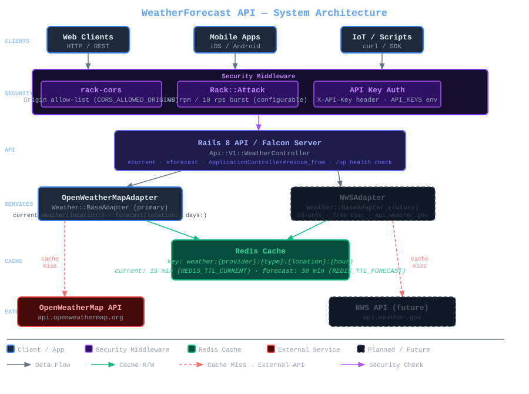

# WeatherForecast API

A Ruby on Rails 8 API application that provides a unified interface for accessing weather forecast data from multiple third-party providers. Built with modern development practices, comprehensive architectural documentation, and designed for scalability.

[](https://www.ruby-lang.org/)
[](https://rubyonrails.org/)
[](LICENSE)

## Table of Contents

- [Overview](#overview)
- [Features](#features)
- [Architecture](#architecture)
- [Technology Stack](#technology-stack)
- [Getting Started](#getting-started)
- [Utility Scripts](#utility-scripts)
- [API Documentation](#api-documentation)
- [Development](#development)
- [Testing](#testing)
- [Deployment](#deployment)
- [Architecture Decisions](#architecture-decisions)
- [Contributing](#contributing)
- [License](#license)

## Overview

WeatherForecast API is a **weather data aggregation and normalization layer** that integrates with third-party weather providers to deliver consistent, cached weather information through a RESTful API.

### Key Capabilities

- **Unified API**: Single interface for multiple weather data providers
- **Smart Caching**: Redis-based caching with configurable TTL (30-minute default)
- **Global Coverage**: Support for worldwide locations via OpenWeatherMap
- **High Performance**: Sub-200ms response times for cached data
- **Modern Architecture**: API-only design with frontend/backend separation
- **Production Ready**: Deployed with Falcon web server and comprehensive monitoring

### Use Cases

- Web applications requiring weather data
- Mobile applications (iOS, Android)
- IoT devices and embedded systems
- Data dashboards and visualization tools
- Third-party integrations

## Features

### Core Features

- ✅ **Current Weather Data**: Real-time weather conditions for any location
- ✅ **Multi-Day Forecasts**: Extended weather forecasts (configurable days)
- ✅ **Multiple Input Formats**: Zipcode, city name, or latitude/longitude
- ✅ **Intelligent Caching**: Zipcode-based caching with automatic expiration
- ✅ **Rate Limit Protection**: Built-in caching reduces external API calls
- ✅ **Error Handling**: Graceful degradation and clear error messages

### Technical Features

- 🚀 **HTTP/2 Support**: Via Falcon web server
- 📦 **RESTful API**: Clean, versioned endpoints (`/api/v1/`)
- 🔄 **Real-time Updates**: Action Cable support for WebSocket connections
- 🔒 **Secure**: Environment-based credential management
- 📊 **Observable**: Structured logging and monitoring ready
- 🧪 **Well Tested**: Comprehensive RSpec test suite

## Architecture

### High-Level Architecture



### Design Principles

1. **API-First Design**: Clean RESTful interface for all consumers
2. **Performance Through Caching**: Aggressive Redis caching with TTL
3. **Testable by Design**: Every method easily tested in isolation
4. **Domain-Driven Design**: Rich domain models (Temperature, Forecast)
5. **Adapter Pattern**: Pluggable weather provider implementations
6. **Stateless**: Horizontally scalable API servers

See [Architecture Documentation](.architecture/) for detailed ADRs.

## Technology Stack

### Core Technologies

- **Language**: Ruby 3.4.6
- **Framework**: Rails 8.0.3 (API-only mode)
- **Web Server**: Falcon (HTTP/2 support)
- **Cache**: Redis 5.4+
- **Testing**: RSpec with FactoryBot, VCR, WebMock

### Weather Providers

- **OpenWeatherMap** (Primary) - Global coverage, free tier available
- **National Weather Service** (Future) - US-only, free, no API key

### Development Tools

- **AI Assistance**: Claude Code CLI for development
- **Commit Standard**: Conventional Commits with aigcm
- **Code Quality**: Brakeman (security), RuboCop (style)
- **Documentation**: Comprehensive ADRs and context files

### Key Gems

```ruby
gem 'rails', '~> 8.0.3'
gem 'falcon-rails', '~> 0.2.4'      # HTTP/2 web server
gem 'redis', '~> 5.0'               # Caching layer
gem 'openweathermap', '~> 0.2.3'   # OpenWeatherMap integration
gem 'nws_openapi_sdk', '~> 0.1.0'  # NWS integration
gem 'rspec-rails'                    # Testing framework
gem 'debug_me'                       # Debugging (never use puts!)
```

## Getting Started

### Prerequisites

- Ruby 3.4.6 (via rbenv or rvm)
- Redis 5.4+ (running locally or remote)
- OpenWeatherMap API key (free tier: https://openweathermap.org/api)
- Bundler 2.5+

### Installation

1. **Clone the repository**
   ```bash
   git clone https://github.com/madbomber/weather_forecast.git
   cd weather_forecast
   ```

2. **Install dependencies**
   ```bash
   bundle install
   ```

3. **Set up environment variables**
   ```bash
   cp .env.example .env
   # Edit .env and add your API keys
   ```

   Required variables:
   ```bash
   OPENWEATHERMAP_API_KEY=your_api_key_here
   REDIS_URL=redis://localhost:6379/0
   SECRET_KEY_BASE=$(rails secret)
   ```

4. **Start Redis** (if not running)
   ```bash
   redis-server
   ```

5. **Start the application**
   ```bash
   bundle exec rails server
   # or
   bundle exec falcon serve
   ```

6. **Verify installation**
   ```bash
   curl http://localhost:3000/up
   # Should return: "OK"
   ```

### Quick Test

```bash
# Get current weather for zipcode
curl http://localhost:3000/api/v1/forecasts/10001

# Expected response:
{
  "location": "10001",
  "timestamp": "2025-10-10T16:00:00Z",
  "temperature": {
    "celsius": 22.5,
    "fahrenheit": 72.5,
    "kelvin": 295.65
  },
  "conditions": "partly cloudy",
  "humidity": 65.0,
  "wind_speed": 15.5,
  "precipitation_chance": 20.0
}
```

## Utility Scripts

The project includes several utility scripts in the `bin/` directory for common development and maintenance tasks.

### Server Management

#### `bin/start.sh` - Start the Application Server

Starts the Weather Forecast API server in the background using Falcon web server.

**Features:**
- Starts server on http://localhost:3000
- Runs in background with PID tracking
- Logs output to `log/server.log`
- Prevents duplicate server instances
- Creates necessary directories automatically

**Usage:**
```bash
bin/start.sh
```

**Output:**
```
Starting Weather Forecast API server...
Environment: development
Binding to: http://localhost:3000
Server started successfully (PID: 12345)
Logs: log/server.log
Stop with: bin/stop.sh
```

**Environment Variables:**
- `RAILS_ENV` - Rails environment (default: development)

#### `bin/stop.sh` - Stop the Application Server

Gracefully stops the running Weather Forecast API server.

**Features:**
- Graceful shutdown with SIGTERM
- Force kill fallback with SIGKILL after 5 seconds
- Cleans up orphaned processes on port 3000
- Removes PID file after shutdown
- Handles missing/stale PID files

**Usage:**
```bash
bin/stop.sh
```

**Output:**
```
Stopping Weather Forecast API server (PID: 12345)...
Server stopped successfully
```

### Weather Data Access

#### `bin/weather.sh` - Query Weather Forecast

CLI tool to query weather forecasts from the running API server.

**Features:**
- Pretty-printed JSON output (via jq)
- Supports all location formats (city, zip, coordinates)
- URL encodes location parameters automatically
- Configurable API endpoint via environment variables

**Usage:**
```bash
bin/weather.sh <location>
```

**Examples:**
```bash
# By city name
bin/weather.sh London

# By zip code
bin/weather.sh 90210

# By city with spaces (use quotes)
bin/weather.sh "New York"

# By coordinates
bin/weather.sh 51.5074,-0.1278
```

**Sample Output:**
```json
{
  "data": [
    {
      "location": "London",
      "timestamp": "2025-10-13T13:00:00-05:00",
      "temperature": {
        "celsius": 15.3,
        "fahrenheit": 59.5,
        "kelvin": 288.5
      },
      "conditions": "Clouds",
      "humidity": 75.0,
      "wind_speed": 4.0,
      "wind_direction": "ENE",
      "precipitation_chance": 0.0,
      "description": "overcast clouds"
    }
  ],
  "performance": {
    "cached": true,
    "duration_ms": 1.96
  }
}
```

**Environment Variables:**
- `API_HOST` - API server hostname (default: localhost)
- `API_PORT` - API server port (default: 3000)

**Requirements:**
- `jq` must be installed for JSON formatting
- Server must be running (use `bin/start.sh`)

### Cache Management

#### `bin/flush_cache.sh` - Clear Weather Cache

Removes all cached weather data from Redis. Useful for development, testing, and maintenance.

**Features:**
- Parses REDIS_URL for connection details
- Counts cache keys before deletion
- Deletes all keys matching "weather:*" pattern
- Verifies successful deletion
- Handles empty cache gracefully

**Usage:**
```bash
bin/flush_cache.sh
```

**Output (with cached data):**
```
Flushing weather cache from Redis...
Redis URL: redis://localhost:6379/0
Found 5 weather cache key(s)
Weather cache flushed successfully (5 key(s) deleted)
```

**Output (empty cache):**
```
Flushing weather cache from Redis...
Redis URL: redis://localhost:6379/0
No weather cache keys found
```

**Environment Variables:**
- `REDIS_URL` - Redis connection URL (default: redis://localhost:6379/0)

**Use Cases:**
- Force fresh API calls during development
- Clear stale data after API changes
- Reset cache before running tests
- Maintenance and troubleshooting

### Script Workflow Example

Complete workflow for development:

```bash
# 1. Start the server
bin/start.sh

# 2. Query weather (uncached - slower)
bin/weather.sh London
# Output shows: "cached": false, "duration_ms": 354.01

# 3. Query same location (cached - fast)
bin/weather.sh London
# Output shows: "cached": true, "duration_ms": 1.96

# 4. Clear cache
bin/flush_cache.sh

# 5. Query again (uncached again)
bin/weather.sh London
# Output shows: "cached": false

# 6. Stop the server
bin/stop.sh
```

## API Documentation

### Base URL

```
Development: http://localhost:3000
Production: https://your-domain.com
```

### Endpoints

#### Get Current Weather

```http
GET /api/v1/forecasts/:location
```

**Parameters:**
- `location` (required): Zipcode, city name, or "lat,lon" coordinates

**Example Requests:**
```bash
# By zipcode
curl http://localhost:3000/api/v1/forecasts/10001

# By city
curl http://localhost:3000/api/v1/forecasts/New%20York

# By coordinates
curl http://localhost:3000/api/v1/forecasts/40.7128,-74.0060
```

**Response:**
```json
{
  "location": "10001",
  "timestamp": "2025-10-10T16:00:00Z",
  "temperature": {
    "celsius": 22.5,
    "fahrenheit": 72.5,
    "kelvin": 295.65
  },
  "conditions": "partly cloudy",
  "humidity": 65.0,
  "wind_speed": 15.5,
  "wind_direction": "NW",
  "precipitation_chance": 20.0,
  "description": "Partly cloudy skies throughout the day"
}
```

**Error Responses:**
```json
// 404 Not Found
{
  "error": "Location not found",
  "message": "The specified location could not be found"
}

// 429 Rate Limited
{
  "error": "Rate limit exceeded",
  "message": "Too many requests. Please try again later."
}

// 500 Server Error
{
  "error": "Internal server error",
  "message": "An unexpected error occurred"
}
```

### Caching

All weather data is cached in Redis with a **30-minute TTL** per location. Subsequent requests for the same location within 30 minutes return cached data instantly.

**Cache Key Format:**
```
weather:openweathermap:10001:123456
         ^provider      ^loc   ^hour_bucket
```

## Development

### Project Structure

```
weather_forecast/
├── app/
│   ├── controllers/
│   │   └── api/v1/          # API endpoints
│   ├── models/
│   │   └── weather/         # Domain models (Temperature, Forecast)
│   └── services/
│       └── weather/         # Weather adapters and services
├── spec/                    # RSpec tests
├── config/                  # Configuration
├── .architecture/           # Architecture Decision Records
│   ├── decisions/adrs/      # ADR documents
│   ├── principles.md        # Architectural principles
│   └── members.yml          # Architecture review team
└── .coding-assistants/
    └── context.md           # AI coding assistant context
```

### Development Guidelines

#### Debugging

**IMPORTANT**: Always use `debug_me` gem, never `puts`:

```ruby
# ❌ NEVER do this
puts "Processing forecast for #{location}"

# ✅ ALWAYS do this
debug_me "Processing forecast for #{location}"

# With variables
debug_me { [:location, :temperature, :conditions] }
```

#### Testing

Run the full test suite:
```bash
bundle exec rspec
```

Run specific tests:
```bash
bundle exec rspec spec/services/weather/openweathermap_adapter_spec.rb
```

Run with coverage:
```bash
COVERAGE=true bundle exec rspec
```

#### Code Quality

```bash
# Security audit
bundle exec brakeman

# Style checking
bundle exec rubocop

# Auto-fix style issues
bundle exec rubocop -a
```

#### Commit Messages

Use **Conventional Commits** format:

```bash
# Install aigcm (AI commit message generator)
npm install -g aigcm

# Stage changes
git add .

# Generate commit message with AI
aigcm

# Or manually follow format:
git commit -m "feat(adapter): add NWS weather adapter"
```

Format: `<type>(<scope>): <description>`

**Types**: feat, fix, docs, style, refactor, perf, test, build, ci, chore

**Scopes**: weather, adapter, cache, api, models, services, tests, docs, adr

### Adding a New Weather Provider

1. **Create adapter class**
   ```ruby
   # app/services/weather/new_provider_adapter.rb
   module Weather
     class NewProviderAdapter < BaseAdapter
       def current_weather(location:)
         # Implementation
       end

       def forecast(location:, days: 7)
         # Implementation
       end
     end
   end
   ```

2. **Write RSpec tests**
   ```ruby
   # spec/services/weather/new_provider_adapter_spec.rb
   require 'rails_helper'

   RSpec.describe Weather::NewProviderAdapter do
     describe '#current_weather' do
       # Tests with VCR cassettes
     end
   end
   ```

3. **Add VCR cassettes** for API recordings

4. **Update configuration** to support new provider

5. **Document in ADR** if significant architectural change

## Testing

### Test Suite

- **Unit Tests**: Value objects, models
- **Service Tests**: Weather adapters with VCR
- **Controller Tests**: API endpoints
- **Integration Tests**: End-to-end workflows

### Running Tests

```bash
# Full suite
bundle exec rspec

# Specific file
bundle exec rspec spec/models/weather/temperature_spec.rb

# Specific test
bundle exec rspec spec/models/weather/temperature_spec.rb:10

# With coverage
COVERAGE=true bundle exec rspec
```

### Test Coverage

Target: **>80% code coverage**

```bash
# Generate coverage report
COVERAGE=true bundle exec rspec
open coverage/index.html
```

### VCR Cassettes

External API calls are recorded with VCR:

```ruby
VCR.use_cassette('openweathermap/current_weather_success') do
  weather = adapter.current_weather(location: '10001')
end
```

Cassettes stored in: `spec/fixtures/vcr_cassettes/`

## Deployment

### Environment Variables

Required for production:

```bash
OPENWEATHERMAP_API_KEY=<production_key>
REDIS_URL=<production_redis_url>
SECRET_KEY_BASE=<secure_random_key>
RAILS_ENV=production
RAILS_LOG_TO_STDOUT=true
RAILS_SERVE_STATIC_FILES=true
```

### Heroku Deployment

```bash
# Create app
heroku create weather-forecast-api

# Add Redis
heroku addons:create heroku-redis:mini

# Set environment variables
heroku config:set OPENWEATHERMAP_API_KEY=your_key

# Deploy
git push heroku main

# Scale
heroku ps:scale web=2
```

### Docker Deployment

```dockerfile
# Dockerfile already included in project
docker build -t weather-forecast-api .
docker run -p 3000:3000 \
  -e OPENWEATHERMAP_API_KEY=your_key \
  -e REDIS_URL=redis://redis:6379/0 \
  weather-forecast-api
```

### Docker Compose

```yaml
version: '3.8'
services:
  web:
    build: .
    ports:
      - "3000:3000"
    environment:
      - REDIS_URL=redis://redis:6379/0
      - OPENWEATHERMAP_API_KEY=${OPENWEATHERMAP_API_KEY}
    depends_on:
      - redis

  redis:
    image: redis:7-alpine
    ports:
      - "6379:6379"
```

## Architecture Decisions

This project uses **Architecture Decision Records (ADRs)** to document significant decisions:

| ADR | Title | Key Decision |
|-----|-------|-------------|
| [ADR-0001](.architecture/decisions/adrs/0001-use-redis-for-caching.md) | Use Redis for Caching | Redis with 30-min TTL for zipcode-based caching |
| [ADR-0002](.architecture/decisions/adrs/0002-api-only-rails-application.md) | API-Only Rails Application | Frontend/backend separation |
| [ADR-0003](.architecture/decisions/adrs/0003-use-falcon-web-server.md) | Use Falcon Web Server | Fiber-based HTTP/2 server for learning |
| [ADR-0004](.architecture/decisions/adrs/0004-choose-openweathermap-as-primary-provider.md) | OpenWeatherMap as Primary | Global coverage over US-only NWS |
| [ADR-0005](.architecture/decisions/adrs/0005-no-database-for-initial-implementation.md) | No Database Initially | Redis sufficient for PoC stage |
| [ADR-0006](.architecture/decisions/adrs/0006-use-rspec-for-testing.md) | Use RSpec for Testing | Scales better for expected project growth |
| [ADR-0007](.architecture/decisions/adrs/0007-allow-ai-coding-agents.md) | Allow AI Coding Agents | Claude Code recommended for development |
| [ADR-0008](.architecture/decisions/adrs/0008-conventional-commits.md) | Conventional Commits | Standard commit format with aigcm |
| [ADR-0009](.architecture/decisions/adrs/0009-use-environment-variables-for-secrets.md) | Environment Variables for Secrets | Simpler for PoC than encrypted credentials |

**Full Documentation**: See [.architecture/](.architecture/) directory

## Contributing

### Getting Started

1. Fork the repository
2. Create a feature branch (`git checkout -b feat/amazing-feature`)
3. Make your changes
4. Write tests (maintain >80% coverage)
5. Use conventional commits (`feat(scope): description`)
6. Push to your fork
7. Open a Pull Request

### Development Workflow

1. **Check existing ADRs** before making architectural changes
2. **Write tests first** (TDD approach)
3. **Use debug_me** for debugging (never puts)
4. **Run RSpec** before committing
5. **Update documentation** if needed
6. **Create ADR** for significant decisions

### Code Review Checklist

- [ ] Tests pass (`bundle exec rspec`)
- [ ] Security check passes (`bundle exec brakeman`)
- [ ] Code style follows RuboCop
- [ ] Test coverage maintained (>80%)
- [ ] Conventional commit format used
- [ ] Documentation updated
- [ ] ADR created if needed

## Performance

### Benchmarks

- **Cached Response**: <200ms (avg: 50ms)
- **Uncached Response**: <2s (depends on external API)
- **Cache Hit Rate**: Target >80%
- **Concurrent Requests**: Supports 100+ concurrent via Falcon

### Caching Strategy

- **TTL**: 30 minutes for weather data
- **Key Format**: `weather:{provider}:{location}:{hour_bucket}`
- **Invalidation**: Automatic expiration via TTL
- **Warming**: Can pre-populate cache for popular locations

### Monitoring

Recommended monitoring:
- Cache hit rate (Redis)
- External API latency
- Error rates by provider
- Response times (p50, p95, p99)

## Roadmap

### Phase 1: PoC (Current)
- ✅ OpenWeatherMap integration
- ✅ Redis caching with TTL
- ✅ Basic API endpoints
- ✅ Comprehensive ADRs

### Phase 2: Production Ready
- [ ] Add NWS adapter (US locations)
- [ ] Multi-provider fallback
- [ ] API authentication
- [ ] Rate limiting per user
- [ ] Metrics and monitoring

### Phase 3: Enhanced Features
- [ ] Historical weather data
- [ ] Weather alerts
- [ ] Geocoding service integration
- [ ] GraphQL API
- [ ] WebSocket real-time updates

### Phase 4: Scale
- [ ] Database for user management
- [ ] Analytics and reporting
- [ ] Multiple API versions
- [ ] Advanced caching strategies

## License

This project is licensed under the MIT License - see the [LICENSE](LICENSE) file for details.

## Acknowledgments

- **OpenWeatherMap** for weather data API
- **National Weather Service** for public weather data
- **Anthropic** for Claude Code development assistance
- **Ruby/Rails Community** for excellent ecosystem

## Contact

**Project Maintainer**: Dewayne VanHoozer

**Project Repository**: https://github.com/madbomber/weather_forecast

**Issues**: https://github.com/madbomber/weather_forecast/issues

---

Built with ❤️ using Ruby on Rails, Redis, and modern development practices.

🤖 This project uses AI-assisted development (Claude Code) following professional standards and comprehensive architectural documentation.
