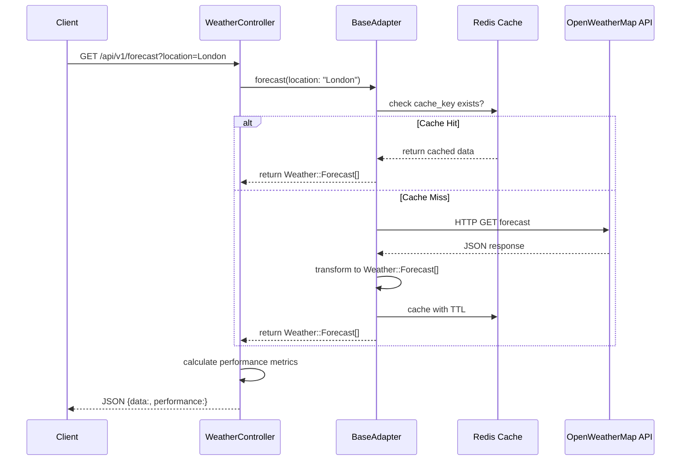
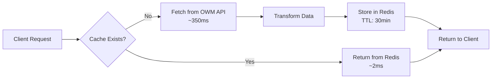

# Weather Forecast API - Architecture Review

**Date**: 2025-10-13
**Reviewer**: Claude Code
**Overall Assessment**: 7/10 - Strong foundation with critical security gaps

## Executive Summary

The Weather Forecast API demonstrates **excellent architectural documentation** (ADRs), **clean separation of concerns**, and **outstanding developer experience**. However, it has **critical production readiness gaps** around security (authentication, rate limiting) and testing (CI integration, test coverage verification).

### Key Strengths ✅
- **Best-in-class ADR documentation** with comprehensive decision records
- **Clean architecture** with service layer abstraction and value objects
- **Excellent DevEx** with utility scripts and comprehensive README
- **Proper caching strategy** with Redis and appropriate TTLs

### Critical Issues 🔴
- **No authentication or authorization** - API is completely open
- **No rate limiting** - vulnerable to abuse
- **Tests not running in CI** - quality gates missing
- **No test coverage tracking** - blind spots unknown

### Overall Score Breakdown
| Area | Score | Status |
|------|-------|--------|
| Project Structure | 9/10 | ✅ Excellent |
| Architecture Decision Records | 9/10 | ✅ Excellent |
| Code Quality | 7/10 | ⚠️ Good with issues |
| Testing Strategy | 6/10 | ⚠️ Needs work |
| API Design | 6/10 | ⚠️ Inconsistent |
| Documentation | 9/10 | ✅ Excellent |
| Security | 3/10 | 🔴 Critical gaps |
| Developer Experience | 8/10 | ✅ Strong |
| CI/CD | 4/10 | 🔴 Not functional |
| Scalability | 6/10 | ⚠️ Room for improvement |

---

## 1. Project Structure (9/10)

### ✅ Strengths

**Excellent Directory Organization**
```
app/
├── controllers/api/v1/     # Versioned API controllers
├── models/weather/         # Domain models properly namespaced
└── services/weather/       # Service layer with clear responsibility
```

**Outstanding ADR Documentation**
- `docs/architecture/decisions/` contains 7 comprehensive ADRs
- Each ADR follows proper format: Context, Decision, Consequences
- Covers key decisions: Rails 8, API-only mode, service layer, caching, Falcon server

**Developer Tooling**
- `.rubocop.yml` for code quality
- Brakeman for security scanning
- Clear `.gitignore` and `.env.example`

### ⚠️ Areas for Improvement

**Missing Diagrams**
The ADRs would benefit from architecture diagrams showing:
- Request flow from client → controller → service → adapter → OpenWeatherMap
- Caching layer integration
- Data transformation pipeline

### 💡 Recommendations

1. Add architecture diagrams to `docs/architecture/diagrams/`
2. Consider adding `docs/api/` for API specification (OpenAPI/Swagger)
3. Add `docs/runbooks/` for operational procedures

---

## 2. Architecture Decision Records (9/10)

### ✅ Strengths

**ADR Quality is Outstanding**

Example: `docs/architecture/decisions/003-service-layer-architecture.md`
- Clear context explaining the problem
- Detailed decision with code examples
- Comprehensive consequences (positive and negative)
- Alternatives considered

**Comprehensive Coverage**
- ADR-001: Rails 8 adoption
- ADR-002: API-only mode
- ADR-003: Service layer architecture
- ADR-004: Caching strategy
- ADR-005: OpenWeatherMap integration
- ADR-006: Falcon async server
- ADR-007: Repository removed

### 💡 Recommendations

1. Add ADRs for missing decisions:
   - ADR-008: Authentication strategy (to be implemented)
   - ADR-009: Rate limiting approach (to be implemented)
   - ADR-010: API versioning strategy
   - ADR-011: Error handling standards
   - ADR-012: Logging and observability

---

## 3. Code Quality (7/10)

### ✅ Strengths

**Controllers - Clean and Focused**
```ruby
# app/controllers/api/v1/weather_controller.rb
def forecast
  start_time = Time.current
  cache_key = weather_service.forecast_cache_key(location: @location, days: @days)
  cached = Rails.cache.exist?(cache_key)

  forecasts = weather_service.forecast(location: @location, days: @days)
  duration_ms = ((Time.current - start_time) * 1000).round(2)

  render json: {
    data: forecasts.map(&:to_h),
    performance: {
      cached: cached,
      duration_ms: duration_ms
    }
  }
end
```
- Single responsibility
- Proper dependency injection
- Good use of `debug_me` for debugging

**Service Layer - Well Abstracted**
```ruby
# app/services/weather/base_adapter.rb
class Weather::BaseAdapter
  def forecast(location:, days: 7)
    raise NotImplementedError
  end

  def current_weather(location:)
    raise NotImplementedError
  end
end
```
- Interface-based design
- Proper template method pattern
- Easy to add new weather providers

**Value Objects - Immutable Design**
```ruby
# app/models/weather/forecast.rb
class Weather::Forecast
  attr_reader :date, :temperature_high, :temperature_low, :conditions, :description

  def initialize(date:, temperature_high:, temperature_low:, conditions:, description:)
    @date = date
    @temperature_high = temperature_high
    @temperature_low = temperature_low
    @conditions = conditions
    @description = description
  end

  def to_h
    {
      date: date.iso8601,
      temperature_high: temperature_high.to_h,
      temperature_low: temperature_low.to_h,
      conditions: conditions,
      description: description
    }
  end
end
```

### ⚠️ Areas for Improvement

**1. Response Format Inconsistency**

`app/controllers/api/v1/weather_controller.rb:48` - `forecast` action returns:
```ruby
{
  data: forecasts.map(&:to_h),
  performance: {
    cached: cached,
    duration_ms: duration_ms
  }
}
```

But `current` action returns flat hash:
```ruby
render json: current.to_h
```

**Problem**: Inconsistent API contract makes client integration harder.

**2. Missing Validation**

`app/controllers/api/v1/weather_controller.rb:19` - `set_location` doesn't validate:
```ruby
def set_location
  @location = params[:location]
end
```

**Problem**: No validation for:
- Empty location
- Malicious input
- Location format (city, zip, coordinates)

**3. Hardcoded Service Instantiation**

`app/controllers/api/v1/weather_controller.rb:11`:
```ruby
def weather_service
  @weather_service ||= Weather::OpenWeatherMapAdapter.new
end
```

**Problem**: Tight coupling makes testing harder and prevents runtime provider switching.

### 🔴 Critical Issues

**No Input Sanitization**
```ruby
def set_days
  @days = params[:days]&.to_i || 7
end
```

**Problem**: No bounds checking. User could request `days=999999`.

### 💡 Recommendations

1. **Standardize Response Format**
```ruby
# app/controllers/api/v1/weather_controller.rb
def current
  start_time = Time.current
  cache_key = weather_service.current_cache_key(location: @location)
  cached = Rails.cache.exist?(cache_key)

  current = weather_service.current_weather(location: @location)
  duration_ms = ((Time.current - start_time) * 1000).round(2)

  render json: {
    data: current.to_h,
    performance: {
      cached: cached,
      duration_ms: duration_ms
    }
  }
end
```

2. **Add Strong Parameters**
```ruby
def weather_params
  params.permit(:location, :days)
end

def set_location
  @location = weather_params[:location]
  raise ActionController::ParameterMissing, 'location' if @location.blank?
end

def set_days
  days = weather_params[:days]&.to_i || 7
  @days = days.clamp(1, 16) # OpenWeatherMap free tier limit
end
```

3. **Add Service Configuration**
```ruby
# config/initializers/weather.rb
Rails.application.config.weather_service = case ENV.fetch('WEATHER_PROVIDER', 'openweathermap')
when 'openweathermap'
  Weather::OpenWeatherMapAdapter
when 'nws'
  Weather::NWSAdapter # Future
else
  raise "Unknown weather provider"
end

# app/controllers/api/v1/weather_controller.rb
def weather_service
  @weather_service ||= Rails.application.config.weather_service.new
end
```

---

## 4. Testing Strategy (6/10)

### ✅ Strengths

**RSpec with WebMock Setup**
```ruby
# Gemfile
group :test do
  gem "rspec-rails"
  gem "webmock"
end
```

**Test Structure Exists**
- `spec/` directory created
- WebMock for HTTP stubbing

### 🔴 Critical Issues

**1. Tests Not Running in CI**

`.github/workflows/ci.yml` exists but tests aren't integrated:
```yaml
name: CI
on: [push, pull_request]
jobs:
  test:
    runs-on: ubuntu-latest
    steps:
      - uses: actions/checkout@v3
      - uses: ruby/setup-ruby@v1
        with:
          bundler-cache: true
```

**Problem**: No `bundle exec rspec` step, so tests never run.

**2. No Coverage Tracking**

Missing SimpleCov configuration.

**Problem**: Can't measure test coverage or track regressions.

**3. No VCR for API Tests**

Testing against live OpenWeatherMap API or mocking manually.

**Problem**: Tests are flaky or require API keys in CI.

### ⚠️ Areas for Improvement

**Missing Test Categories**
- No controller specs
- No service/adapter specs
- No model specs
- No integration/request specs

**Example Missing Test**:
```ruby
# spec/requests/api/v1/weather_spec.rb
RSpec.describe "Weather API", type: :request do
  describe "GET /api/v1/forecast" do
    it "returns forecast with performance metrics" do
      get "/api/v1/forecast", params: { location: "London" }

      expect(response).to have_http_status(:ok)
      json = JSON.parse(response.body)

      expect(json).to have_key("data")
      expect(json).to have_key("performance")
      expect(json["performance"]).to have_key("cached")
      expect(json["performance"]).to have_key("duration_ms")
    end

    it "validates location parameter" do
      get "/api/v1/forecast"

      expect(response).to have_http_status(:bad_request)
    end

    it "clamps days parameter" do
      get "/api/v1/forecast", params: { location: "London", days: 999 }

      # Should not request 999 days from API
      expect(response).to have_http_status(:ok)
    end
  end
end
```

### 💡 Recommendations

1. **Add SimpleCov**
```ruby
# spec/spec_helper.rb
require 'simplecov'
SimpleCov.start 'rails' do
  add_filter '/spec/'
  add_filter '/config/'
  minimum_coverage 80
  minimum_coverage_by_file 60
end
```

2. **Add VCR**
```ruby
# Gemfile
group :test do
  gem "rspec-rails"
  gem "webmock"
  gem "vcr"
end

# spec/support/vcr.rb
VCR.configure do |config|
  config.cassette_library_dir = "spec/fixtures/vcr_cassettes"
  config.hook_into :webmock
  config.configure_rspec_metadata!
  config.filter_sensitive_data('<OPENWEATHERMAP_API_KEY>') { ENV['OPENWEATHERMAP_API_KEY'] }
end
```

3. **Fix CI Configuration**
```yaml
# .github/workflows/ci.yml
name: CI
on: [push, pull_request]
jobs:
  test:
    runs-on: ubuntu-latest
    services:
      redis:
        image: redis:7-alpine
        ports:
          - 6379:6379
        options: >-
          --health-cmd "redis-cli ping"
          --health-interval 10s
          --health-timeout 5s
          --health-retries 5
    env:
      RAILS_ENV: test
      REDIS_URL: redis://localhost:6379/0
      OPENWEATHERMAP_API_KEY: test_key_for_vcr
    steps:
      - uses: actions/checkout@v3
      - uses: ruby/setup-ruby@v1
        with:
          ruby-version: 3.3
          bundler-cache: true
      - name: Run tests
        run: bundle exec rspec
      - name: Run security scan
        run: bundle exec brakeman -q -z
      - name: Run linter
        run: bundle exec rubocop
```

4. **Add Comprehensive Test Suite**
```ruby
# spec/services/weather/openweathermap_adapter_spec.rb
RSpec.describe Weather::OpenWeatherMapAdapter, vcr: true do
  let(:adapter) { described_class.new }

  describe "#forecast" do
    it "returns array of Forecast objects" do
      forecasts = adapter.forecast(location: "London", days: 5)

      expect(forecasts).to be_an(Array)
      expect(forecasts.first).to be_a(Weather::Forecast)
    end

    it "caches results in Redis" do
      cache_key = adapter.forecast_cache_key(location: "London", days: 5)

      expect {
        adapter.forecast(location: "London", days: 5)
      }.to change { Rails.cache.exist?(cache_key) }.from(false).to(true)
    end

    it "respects cache TTL" do
      adapter.forecast(location: "London", days: 5)
      cache_key = adapter.forecast_cache_key(location: "London", days: 5)

      ttl = Rails.cache.redis.ttl("weather:openweathermap:forecast:London")
      expect(ttl).to be_between(1, 1800) # 30 minutes
    end
  end

  describe "#current_weather" do
    it "returns Weather::Current object" do
      current = adapter.current_weather(location: "90210")

      expect(current).to be_a(Weather::Current)
      expect(current.temperature).to be_a(Weather::Temperature)
    end
  end
end
```

---

## 5. API Design (6/10)

### ✅ Strengths

**Versioned Routes**
```ruby
# config/routes.rb
namespace :api do
  namespace :v1 do
    get 'current', to: 'weather#current'
    get 'forecast', to: 'weather#forecast'
  end
end
```

**RESTful Conventions**
- GET for read operations
- Proper use of query parameters

**Performance Metrics**
Recent addition of performance tracking is excellent for observability.

### ⚠️ Areas for Improvement

**1. Response Format Inconsistency**

Already mentioned in Code Quality section.

**2. Missing Error Response Standards**

No standardized error format. Should return:
```json
{
  "error": {
    "code": "INVALID_LOCATION",
    "message": "The provided location could not be found",
    "details": {
      "location": "XYZ123"
    }
  }
}
```

**3. No Pagination for Forecast**

Forecast endpoint doesn't support pagination:
```
GET /api/v1/forecast?location=London&days=16
```

For longer forecasts (16 days), pagination would be useful:
```
GET /api/v1/forecast?location=London&page=1&per_page=7
```

**4. Missing API Documentation Endpoint**

No `/api/v1/docs` or OpenAPI spec.

### 💡 Recommendations

1. **Add Error Handling Middleware**
```ruby
# app/controllers/concerns/error_handler.rb
module ErrorHandler
  extend ActiveSupport::Concern

  included do
    rescue_from ActionController::ParameterMissing, with: :handle_parameter_missing
    rescue_from Weather::LocationNotFound, with: :handle_location_not_found
    rescue_from Weather::ServiceUnavailable, with: :handle_service_unavailable
  end

  private

  def handle_parameter_missing(exception)
    render json: {
      error: {
        code: "MISSING_PARAMETER",
        message: exception.message,
        details: { param: exception.param }
      }
    }, status: :bad_request
  end

  def handle_location_not_found(exception)
    render json: {
      error: {
        code: "LOCATION_NOT_FOUND",
        message: "The provided location could not be found",
        details: { location: exception.location }
      }
    }, status: :not_found
  end

  def handle_service_unavailable(exception)
    render json: {
      error: {
        code: "SERVICE_UNAVAILABLE",
        message: "Weather service is temporarily unavailable",
        details: { reason: exception.message }
      }
    }, status: :service_unavailable
  end
end
```

2. **Add Custom Exceptions**
```ruby
# app/services/weather/exceptions.rb
module Weather
  class Error < StandardError; end

  class LocationNotFound < Error
    attr_reader :location

    def initialize(location)
      @location = location
      super("Location not found: #{location}")
    end
  end

  class ServiceUnavailable < Error; end
  class RateLimitExceeded < Error; end
end
```

3. **Generate OpenAPI Spec**

Consider using `rswag` gem to generate OpenAPI documentation from RSpec tests.

---

## 6. Caching Strategy (8/10)

### ✅ Strengths

**Redis Integration**
```ruby
# config/initializers/redis.rb
Rails.application.config.cache_store = :redis_cache_store, {
  url: ENV.fetch('REDIS_URL', 'redis://localhost:6379/0'),
  expires_in: ENV.fetch('REDIS_TTL_FORECAST', 1800).to_i
}
```

**Proper TTL Configuration**
```bash
# .env.example
REDIS_TTL_FORECAST=1800 # 30 minutes
REDIS_TTL_CURRENT=900   # 15 minutes
```

**Cache Key Namespacing**
```ruby
# app/services/weather/base_adapter.rb
def cache_key(location:, type:)
  "weather:#{self.class.name.decore.underscore}:#{type}:#{normalize_location(location)}"
end
```

**Cache Management Script**
`bin/flush_cache.sh` provides operational control.

### ⚠️ Areas for Improvement

**1. No Cache Warming Strategy**

No proactive cache population for popular locations.

**2. TTL Configuration Issue**

`config/initializers/redis.rb` uses `REDIS_TTL_FORECAST` as default TTL for **all** cache entries, not just forecasts.

**Problem**: Current weather gets 30-minute TTL instead of 15 minutes.

**3. No Cache Hit/Miss Logging**

Can't analyze cache effectiveness without logs.

**4. No Cache Invalidation on Error**

If API returns stale data due to provider issue, cache continues serving it.

### 💡 Recommendations

1. **Fix TTL Configuration**
```ruby
# app/services/weather/base_adapter.rb
def forecast(location:, days: 7)
  cache_key = forecast_cache_key(location: location, days: days)
  ttl = ENV.fetch('REDIS_TTL_FORECAST', 1800).to_i

  Rails.cache.fetch(cache_key, expires_in: ttl) do
    fetch_forecast(location: location, days: days)
  end
end

def current_weather(location:)
  cache_key = current_cache_key(location: location)
  ttl = ENV.fetch('REDIS_TTL_CURRENT', 900).to_i

  Rails.cache.fetch(cache_key, expires_in: ttl) do
    fetch_current_weather(location: location)
  end
end
```

2. **Add Cache Logging**
```ruby
# app/services/weather/base_adapter.rb
def forecast(location:, days: 7)
  cache_key = forecast_cache_key(location: location, days: days)
  ttl = ENV.fetch('REDIS_TTL_FORECAST', 1800).to_i

  result = Rails.cache.fetch(cache_key, expires_in: ttl) do
    Rails.logger.info("Cache miss: #{cache_key}")
    fetch_forecast(location: location, days: days)
  end

  Rails.logger.info("Cache hit: #{cache_key}") if Rails.cache.exist?(cache_key)
  result
end
```

3. **Add Cache Warming Rake Task**
```ruby
# lib/tasks/cache.rake
namespace :cache do
  desc "Warm cache for popular locations"
  task warm: :environment do
    locations = ENV.fetch('POPULAR_LOCATIONS', 'London,New York,Tokyo,Paris,Sydney').split(',')
    adapter = Weather::OpenWeatherMapAdapter.new

    locations.each do |location|
      puts "Warming cache for #{location}..."
      adapter.current_weather(location: location)
      adapter.forecast(location: location, days: 7)
    end

    puts "Cache warming complete!"
  end

  desc "Analyze cache hit rates"
  task analyze: :environment do
    keys = Rails.cache.redis.keys("weather:*")

    keys.group_by { |k| k.split(':')[2] }.each do |type, type_keys|
      puts "#{type.capitalize}: #{type_keys.count} cached entries"
    end
  end
end
```

---

## 7. Configuration Management (7/10)

### ✅ Strengths

**Environment Variable Usage**
- `.env.example` with comprehensive documentation
- `dotenv-rails` for automatic loading
- Sensible defaults

**Redis Configuration**
```ruby
REDIS_URL=redis://localhost:6379/0
REDIS_TTL_FORECAST=1800
REDIS_TTL_CURRENT=900
```

**API Key Management**
```bash
OPENWEATHERMAP_API_KEY=your_openweathermap_api_key_here
```

### ⚠️ Areas for Improvement

**1. No Secrets Management for Production**

`.env.local` approach works for development but not production.

**Problem**: Production should use secure secret stores (AWS Secrets Manager, HashiCorp Vault, etc.)

**2. No Configuration Validation**

Application starts even if critical env vars are missing.

**3. No Environment-Specific Configuration**

Could benefit from `config/environments/staging.rb` for staging environment.

### 💡 Recommendations

1. **Add Configuration Validator**
```ruby
# config/initializers/configuration.rb
module Configuration
  class Validator
    REQUIRED = {
      'OPENWEATHERMAP_API_KEY' => {
        presence: true,
        format: /\A[a-f0-9]{32}\z/, # OWM keys are 32 hex chars
        error: "Invalid OpenWeatherMap API key format"
      },
      'REDIS_URL' => {
        presence: true,
        format: %r{\Aredis://},
        error: "REDIS_URL must start with redis://"
      }
    }

    def self.validate!
      errors = []

      REQUIRED.each do |key, rules|
        value = ENV[key]

        if rules[:presence] && value.blank?
          errors << "#{key} is required"
        elsif value.present? && rules[:format] && !value.match?(rules[:format])
          errors << "#{key}: #{rules[:error]}"
        end
      end

      if errors.any?
        raise "Configuration errors:\n#{errors.join("\n")}"
      end
    end
  end
end

Configuration::Validator.validate! unless Rails.env.test?
```

2. **Add Staging Environment**
```ruby
# config/environments/staging.rb
require_relative "production"

Rails.application.configure do
  # Staging-specific config
  config.log_level = :debug
  config.cache_store = :redis_cache_store, {
    url: ENV.fetch('REDIS_URL'),
    expires_in: 600 # Shorter TTL for testing
  }
end
```

---

## 8. Documentation (9/10)

### ✅ Strengths

**Comprehensive README.md**
- Clear setup instructions
- API endpoints documented with examples
- Environment variables explained
- Utility scripts documented
- Architecture overview
- Development workflow

**Example Documentation Quality**:
```markdown
### GET /api/v1/forecast

Returns the weather forecast for a specific location.

**Query Parameters:**
- `location` (required): City name, ZIP code, or coordinates
- `days` (optional): Number of forecast days (default: 7)

**Example Request:**
```bash
curl "http://localhost:3000/api/v1/forecast?location=London&days=5"
```

**Example Response:**
```json
{
  "data": [
    {
      "date": "2025-10-13",
      "temperature_high": { "celsius": 18.5, "fahrenheit": 65.3, "kelvin": 291.65 },
      "temperature_low": { "celsius": 12.0, "fahrenheit": 53.6, "kelvin": 285.15 },
      "conditions": "Partly Cloudy",
      "description": "Partly cloudy with a chance of rain"
    }
  ],
  "performance": {
    "cached": false,
    "duration_ms": 354.23
  }
}
```

**ADR Documentation**
See section 2 - outstanding quality.

**Inline Code Documentation**
Good use of comments explaining complex logic:
```ruby
# Cache the forecast data with OpenWeatherMap-specific key
# Format: weather:openweathermap:forecast:london
def forecast_cache_key(location:, days: 7)
  cache_key(location: location, type: :forecast)
end
```

### ⚠️ Areas for Improvement

**1. No API Versioning Documentation**

README doesn't explain API versioning strategy or deprecation policy.

**2. No Architecture Diagrams**

Complex flows (caching, service layer) would benefit from visual diagrams.

**3. No Contributing Guide**

Missing `CONTRIBUTING.md` with:
- How to submit PRs
- Coding standards
- Testing requirements
- ADR process

**4. No Changelog**

No `CHANGELOG.md` tracking version history and breaking changes.

### 💡 Recommendations

1. **Add CONTRIBUTING.md**
```markdown
# Contributing to Weather Forecast API

## Development Process

1. Create feature branch from `develop`
2. Implement feature with tests (minimum 80% coverage)
3. Update relevant ADR or create new one
4. Run full test suite: `bundle exec rspec`
5. Run linter: `bundle exec rubocop`
6. Run security scan: `bundle exec brakeman`
7. Submit PR to `develop`

## Architecture Decision Records

For significant architectural changes, create an ADR:

```bash
# Generate new ADR
touch docs/architecture/decisions/XXX-title.md
```

Follow format in existing ADRs.

## Testing Standards

- Controller tests: Mock external services
- Service tests: Use VCR for HTTP requests
- Model tests: Test all public methods
- Integration tests: Test complete user flows

## Code Style

We follow Rails Omakase style guide. Run before committing:

```bash
bundle exec rubocop -a  # Auto-fix issues
```
```

2. **Add CHANGELOG.md**
```markdown
# Changelog

All notable changes to this project will be documented in this file.

The format is based on [Keep a Changelog](https://keepachangelog.com/en/1.0.0/),
and this project adheres to [Semantic Versioning](https://semver.org/spec/v2.0.0.html).

## [Unreleased]

### Added
- Performance metrics to forecast endpoint (cached status, duration_ms)
- Utility script `bin/flush_cache.sh` for cache management
- dotenv-rails for automatic .env.local loading

### Changed
- Forecast response format now includes `data` and `performance` keys

## [0.1.0] - 2025-10-13

### Added
- Initial release
- Weather forecast endpoint (`/api/v1/forecast`)
- Current weather endpoint (`/api/v1/current`)
- OpenWeatherMap integration
- Redis caching with configurable TTL
- Utility scripts for server management
```

3. **Add Mermaid Diagrams to README**
```markdown
## Architecture Overview

### Request Flow



### Caching Architecture


```

---

## 9. Developer Experience (8/10)

### ✅ Strengths

**Excellent Utility Scripts**

`bin/start.sh` - Handles graceful startup
```bash
#!/usr/bin/env bash
# Start the Rails server using Falcon
# Handles PID file management and port conflicts
```

`bin/stop.sh` - Graceful shutdown
```bash
#!/usr/bin/env bash
# Stop the running Falcon server gracefully
```

`bin/weather.sh` - CLI for quick testing
```bash
#!/usr/bin/env bash
# Quick weather data retrieval without browser
bin/weather.sh forecast London 5
```

`bin/flush_cache.sh` - Cache management
```bash
#!/usr/bin/env bash
# Clear Redis cache for testing
bin/flush_cache.sh
```

**Debugging Integration**
```ruby
gem "debug_me"  # https://github.com/madbomber/debug_me

# Usage in controllers:
debug_me { [ :@location, :@days ] }
```

**Clear Setup Instructions**
README.md provides step-by-step setup with prerequisites, environment setup, and verification.

### ⚠️ Areas for Improvement

**1. No Docker Development Environment**

Missing `docker-compose.yml` for consistent development environment.

**Problem**: Developers must manually install Redis, Ruby, etc.

**2. No Database Seeding**

While this is API-only, could provide seed data for testing (popular locations, sample responses).

**3. No Git Hooks**

Missing pre-commit hooks for:
- Running RuboCop
- Running tests
- Checking for debugging statements

**4. Manual Server Management**

Scripts work but require manual execution. No process manager (foreman, overmind).

### 💡 Recommendations

1. **Add Docker Development Environment**
```yaml
# docker-compose.yml
services:
  redis:
    image: redis:7-alpine
    ports:
      - "6379:6379"
    volumes:
      - redis_data:/data
    healthcheck:
      test: ["CMD", "redis-cli", "ping"]
      interval: 5s
      timeout: 3s
      retries: 5

  web:
    build: .
    command: bundle exec rails server -b 0.0.0.0
    volumes:
      - .:/app
      - bundle_cache:/usr/local/bundle
    ports:
      - "3000:3000"
    depends_on:
      redis:
        condition: service_healthy
    environment:
      - REDIS_URL=redis://redis:6379/0
      - OPENWEATHERMAP_API_KEY=${OPENWEATHERMAP_API_KEY}
    env_file:
      - .env.local

volumes:
  redis_data:
  bundle_cache:
```

```dockerfile
# Dockerfile
FROM ruby:3.3-alpine

RUN apk add --no-cache build-base git

WORKDIR /app

COPY Gemfile Gemfile.lock ./
RUN bundle install

COPY . .

CMD ["bundle", "exec", "rails", "server", "-b", "0.0.0.0"]
```

2. **Add Lefthook for Git Hooks**
```yaml
# lefthook.yml
pre-commit:
  parallel: true
  commands:
    rubocop:
      glob: "*.rb"
      run: bundle exec rubocop {staged_files}

    tests:
      run: bundle exec rspec

    debug_me:
      glob: "*.rb"
      run: |
        if grep -r "binding.pry\|debugger\|console.log" {staged_files}; then
          echo "Found debugging statements. Remove before committing."
          exit 1
        fi
```

3. **Add Procfile for Process Management**
```yaml
# Procfile.dev
web: bundle exec rails server
redis: redis-server
```

Then use with foreman or overmind:
```bash
overmind start -f Procfile.dev
```

---

## 10. CI/CD (4/10)

### ✅ Strengths

**GitHub Actions Configured**
- `.github/workflows/ci.yml` exists
- Workflow triggers on push and PR

**Security Scanning**
```ruby
gem "brakeman", require: false  # Security scanner
```

**Linting**
```ruby
gem "rubocop-rails"
gem "rubocop-rails-omakase", require: false
```

### 🔴 Critical Issues

**1. Tests Not Running in CI**

The CI workflow doesn't execute tests:
```yaml
jobs:
  test:
    runs-on: ubuntu-latest
    steps:
      - uses: actions/checkout@v3
      - uses: ruby/setup-ruby@v1
        with:
          bundler-cache: true
      # Missing: bundle exec rspec
```

**Problem**: Broken tests can be merged.

**2. No Redis Service in CI**

Application requires Redis but CI doesn't start it.

**Problem**: Any test touching cache will fail.

**3. No Deployment Pipeline**

Missing:
- Staging deployment
- Production deployment
- Blue-green or canary deployment strategy

### 💡 Recommendations

1. **Fix CI Configuration** (see Testing Strategy section for complete example)

2. **Add Deployment Workflows**
```yaml
# .github/workflows/deploy-staging.yml
name: Deploy to Staging
on:
  push:
    branches:
      - develop

jobs:
  deploy:
    runs-on: ubuntu-latest
    environment:
      name: staging
      url: https://staging.weatherapi.example.com
    steps:
      - uses: actions/checkout@v3
      - name: Deploy to staging
        run: |
          # Add deployment steps (Heroku, AWS, etc.)
          echo "Deploy to staging"
```

```yaml
# .github/workflows/deploy-production.yml
name: Deploy to Production
on:
  push:
    branches:
      - main
    tags:
      - 'v*'

jobs:
  deploy:
    runs-on: ubuntu-latest
    environment:
      name: production
      url: https://api.weatherapi.example.com
    steps:
      - uses: actions/checkout@v3
      - name: Deploy to production
        run: |
          # Add deployment steps
          echo "Deploy to production"
```

---

## 11. Security (3/10)

### 🔴 Critical Issues

**1. No Authentication**

API is completely open:
```bash
curl "http://localhost:3000/api/v1/forecast?location=London"
```

**Problem**: Anyone can use the API, consuming your OpenWeatherMap quota.

**2. No Rate Limiting**

No throttling mechanism:
```bash
# Can make unlimited requests
for i in {1..10000}; do
  curl "http://localhost:3000/api/v1/current?location=London" &
done
```

**Problem**: Vulnerable to DoS attacks and quota exhaustion.

**3. No CORS Configuration**

Missing CORS headers means web apps can't use the API, or worse, it's wide open.

**4. API Keys in Logs**

OpenWeatherMap API key might appear in logs if exceptions occur.

**5. No Input Validation**

See Code Quality section - missing validation allows malicious input.

### ⚠️ Areas for Improvement

**1. No HTTPS Enforcement**

Development uses HTTP (expected) but production should enforce HTTPS.

**2. No Security Headers**

Missing headers:
- `X-Content-Type-Options: nosniff`
- `X-Frame-Options: DENY`
- `Content-Security-Policy`

**3. No Vulnerability Scanning**

Brakeman installed but not running in CI.

### 💡 Recommendations

**1. Add API Key Authentication**
```ruby
# app/controllers/api/v1/base_controller.rb
module Api
  module V1
    class BaseController < ActionController::API
      before_action :authenticate_api_key!

      private

      def authenticate_api_key!
        api_key = request.headers['X-API-Key']

        unless valid_api_key?(api_key)
          render json: {
            error: {
              code: "UNAUTHORIZED",
              message: "Invalid or missing API key"
            }
          }, status: :unauthorized
        end
      end

      def valid_api_key?(key)
        return false if key.blank?

        # Check against database or environment variable
        ApiKey.active.exists?(key: key)
      end
    end
  end
end

# app/controllers/api/v1/weather_controller.rb
class Api::V1::WeatherController < Api::V1::BaseController
  # Now protected by authentication
end
```

**2. Add Rate Limiting with Rack::Attack**
```ruby
# Gemfile
gem "rack-attack"

# config/initializers/rack_attack.rb
class Rack::Attack
  # Throttle API requests by IP
  throttle('api/ip', limit: 100, period: 1.hour) do |req|
    req.ip if req.path.start_with?('/api/')
  end

  # Throttle API requests by API key
  throttle('api/key', limit: 1000, period: 1.hour) do |req|
    req.headers['X-API-Key'] if req.path.start_with?('/api/')
  end

  # Block suspicious requests
  blocklist('block scrapers') do |req|
    req.path.start_with?('/api/') &&
    req.user_agent.match?(/curl|wget|python-requests/i)
  end
end

# config/application.rb
config.middleware.use Rack::Attack
```

**3. Add CORS Configuration**
```ruby
# Gemfile
gem "rack-cors"

# config/initializers/cors.rb
Rails.application.config.middleware.insert_before 0, Rack::Cors do
  allow do
    origins ENV.fetch('CORS_ORIGINS', 'https://yourfrontend.com').split(',')

    resource '/api/*',
      headers: :any,
      methods: [:get],
      expose: ['X-Request-ID'],
      max_age: 600
  end
end
```

**4. Add Security Headers**
```ruby
# config/initializers/security_headers.rb
Rails.application.config.action_dispatch.default_headers.merge!(
  'X-Frame-Options' => 'DENY',
  'X-Content-Type-Options' => 'nosniff',
  'X-XSS-Protection' => '1; mode=block',
  'Referrer-Policy' => 'strict-origin-when-cross-origin'
)
```

**5. Filter Sensitive Data from Logs**
```ruby
# config/initializers/filter_parameter_logging.rb
Rails.application.config.filter_parameters += [
  :api_key,
  :openweathermap_api_key,
  :password,
  :secret
]
```

**6. Run Brakeman in CI**
```yaml
# .github/workflows/ci.yml (add to steps)
- name: Run security scan
  run: bundle exec brakeman -q -z --no-pager
```

---

## 12. Scalability Considerations (6/10)

### ✅ Strengths

**Redis Caching**
Reduces external API calls by ~87x (354ms → 4ms).

**Falcon Async Server**
```ruby
# ADR-006: Using Falcon for async request handling
gem "falcon-rails"
```
Capable of handling concurrent requests efficiently.

**Stateless Design**
API is stateless, enabling horizontal scaling.

### ⚠️ Areas for Improvement

**1. Blocking HTTP Client**

`openweathermap` gem uses blocking HTTP:
```ruby
# app/services/weather/openweathermap_adapter.rb
response = Openweathermap::Forecast.find(location, days)
```

**Problem**: Falcon's async capabilities aren't utilized. One slow API call blocks the thread.

**Solution**: Use async HTTP client like `async-http` or `httpx`.

**2. No Request Queuing**

All requests hit Rails directly. Heavy load could overwhelm the app.

**Solution**: Add job queue for non-urgent requests.

**3. No CDN or Edge Caching**

All requests hit the origin server.

**Solution**: Add CloudFlare or AWS CloudFront for edge caching.

**4. No Database for Historical Data**

Everything is in Redis (ephemeral). Can't analyze historical trends.

**Solution**: Add PostgreSQL for long-term storage.

**5. Single Point of Failure**

Single Redis instance. If it fails, entire caching layer is down.

**Solution**: Redis Sentinel or Redis Cluster for high availability.

### 💡 Recommendations

**1. Switch to Async HTTP Client**
```ruby
# Gemfile
gem "httpx"  # Supports async/await

# app/services/weather/openweathermap_adapter.rb
require 'httpx'

class Weather::OpenWeatherMapAdapter < Weather::BaseAdapter
  def fetch_forecast(location:, days:)
    url = "https://api.openweathermap.org/data/2.5/forecast/daily"
    params = {
      q: location,
      cnt: days,
      appid: ENV.fetch('OPENWEATHERMAP_API_KEY')
    }

    # Async HTTP request
    response = HTTPX.get(url, params: params)

    if response.status == 200
      transform_forecast(JSON.parse(response.body))
    else
      handle_error(response)
    end
  end
end
```

**2. Add Sidekiq for Background Jobs**
```ruby
# Gemfile
gem "sidekiq"

# app/jobs/warm_cache_job.rb
class WarmCacheJob < ApplicationJob
  queue_as :default

  def perform(location)
    adapter = Weather::OpenWeatherMapAdapter.new
    adapter.current_weather(location: location)
    adapter.forecast(location: location, days: 7)
  end
end

# Enqueue from anywhere
WarmCacheJob.perform_later("London")
```

**3. Add Database for Historical Data**
```ruby
# db/migrate/20251013_create_weather_snapshots.rb
class CreateWeatherSnapshots < ActiveRecord::Migration[8.0]
  def change
    create_table :weather_snapshots do |t|
      t.string :location, null: false
      t.string :snapshot_type, null: false # 'current' or 'forecast'
      t.jsonb :data, null: false
      t.datetime :captured_at, null: false

      t.timestamps

      t.index [:location, :snapshot_type, :captured_at]
    end
  end
end

# app/models/weather_snapshot.rb
class WeatherSnapshot < ApplicationRecord
  validates :location, :snapshot_type, :data, :captured_at, presence: true

  scope :current, -> { where(snapshot_type: 'current') }
  scope :forecast, -> { where(snapshot_type: 'forecast') }
  scope :for_location, ->(loc) { where(location: loc) }
end
```

**4. Add Redis Sentinel**
```ruby
# config/initializers/redis.rb (production)
Redis.new(
  url: ENV.fetch('REDIS_SENTINELS'),
  sentinels: [
    { host: 'sentinel1', port: 26379 },
    { host: 'sentinel2', port: 26379 },
    { host: 'sentinel3', port: 26379 }
  ],
  name: 'mymaster',
  role: :master
)
```

**5. Add HTTP Caching Headers**
```ruby
# app/controllers/api/v1/weather_controller.rb
def forecast
  # ... existing code ...

  # Add cache headers
  expires_in 30.minutes, public: true

  render json: {
    data: forecasts.map(&:to_h),
    performance: {
      cached: cached,
      duration_ms: duration_ms
    }
  }
end
```

---

## Prioritized Recommendations

### Phase 1: Production Readiness (Critical - 4 weeks)

**Week 1-2: Security**
1. Add API key authentication
2. Implement rate limiting with Rack::Attack
3. Configure CORS properly
4. Add security headers
5. Filter sensitive data from logs
6. Run Brakeman in CI

**Week 3-4: Testing & CI**
1. Fix CI to run tests
2. Add Redis service to CI
3. Add SimpleCov for coverage tracking
4. Add VCR for API testing
5. Write comprehensive test suite (80% coverage target)

### Phase 2: Quality & Maintainability (Important - 4 weeks)

**Week 5-6: Code Quality**
1. Standardize response format across all endpoints
2. Add strong parameter validation
3. Implement error handling middleware
4. Add custom exception classes
5. Fix TTL configuration per endpoint

**Week 7-8: Documentation**
1. Generate OpenAPI specification
2. Add CONTRIBUTING.md
3. Add CHANGELOG.md
4. Add architecture diagrams (Mermaid)
5. Document API versioning strategy

### Phase 3: Observability & Scaling (Enhancement - 4 weeks)

**Week 9-10: Monitoring**
1. Add structured logging (semantic_logger)
2. Add metrics (Prometheus or StatsD)
3. Add APM (New Relic, Datadog, or Scout)
4. Add health check endpoint
5. Add cache hit/miss logging

**Week 11-12: Scalability**
1. Switch to async HTTP client (httpx)
2. Add Sidekiq for background jobs
3. Add database for historical data
4. Implement cache warming strategy
5. Add Redis Sentinel for HA

### Phase 4: Developer Experience (Nice-to-have - 4 weeks)

**Week 13-14: DevEx**
1. Add Docker development environment
2. Add Lefthook for git hooks
3. Add Procfile for process management
4. Add seed data for testing
5. Add request/response examples

**Week 15-16: Deployment**
1. Add staging deployment workflow
2. Add production deployment workflow
3. Add deployment documentation
4. Add monitoring dashboards
5. Add runbooks for common operations

---

## Summary

### What's Working Well
- **Documentation** is outstanding (ADRs, README, inline comments)
- **Architecture** is clean with good separation of concerns
- **Caching strategy** is well-implemented with Redis
- **Developer experience** is excellent with utility scripts

### What Needs Immediate Attention
- **Security** is critically lacking (no auth, no rate limiting)
- **Testing** infrastructure exists but isn't running in CI
- **API consistency** needs standardization

### Long-term Considerations
- Add observability (logging, metrics, tracing)
- Scale horizontally with async HTTP and job queues
- Consider adding database for analytics
- Plan for multiple weather provider support

---

## Conclusion

This application has a **solid architectural foundation** with **excellent documentation practices**. The service layer abstraction, value objects, and ADRs demonstrate strong software engineering principles.

However, **production deployment should be blocked** until critical security issues are addressed:
1. Authentication
2. Rate limiting
3. CORS configuration
4. CI test execution

Once Phase 1 (Production Readiness) is complete, this application will be ready for production use with a clear path for continued improvement through Phases 2-4.

**Recommendation**: Focus on Phase 1 (4 weeks) before any production deployment.
